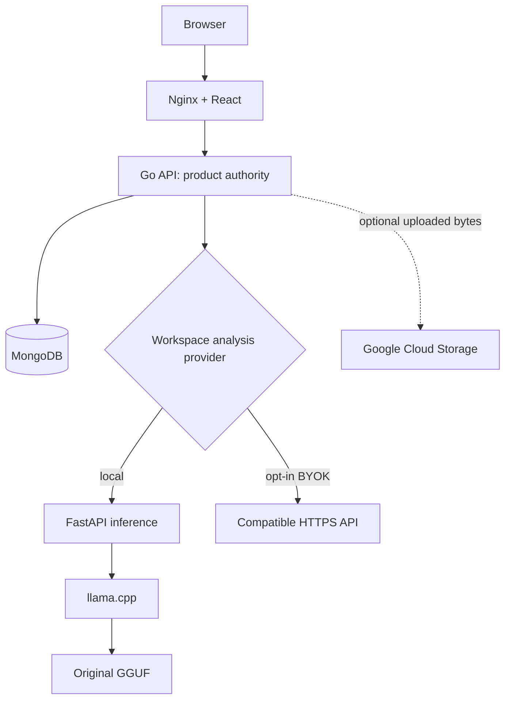
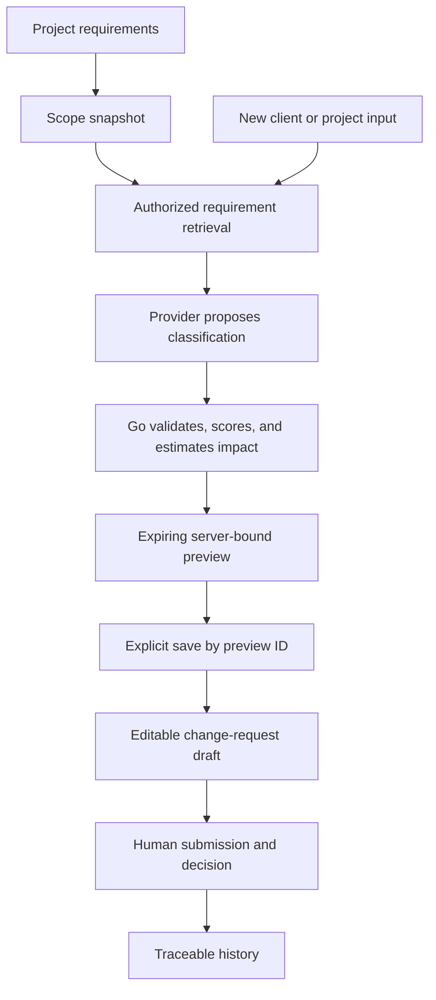

# Drift

Drift tracks how project requirements move after scope is agreed. It turns a later client request into a proposed comparison against a saved scope snapshot, shows the likely impact, and keeps the decision with the people responsible for the project.

The technically interesting boundary is deliberate: a local model or a workspace-owned external provider can suggest a classification, but the Go application owns authorization, scoring, persistence, and workflow state.

## What Drift Does

Teams capture requirements in a project, save a versioned scope snapshot, and compare new input with that snapshot. Drift retrieves relevant requirements, proposes one of six drift labels, presents affected scope with a heuristic impact score and additional-effort estimate, and supports an editable change request. Submission and an owner/admin decision are separate actions. Saved analyses, requests, and decisions provide a traceable history; a snapshot alone does **not** formally approve its contents.

## The Problem

Scope changes often arrive in messages long before anyone updates the original agreement. Without a stable reference, it is difficult to tell what changed, which requirements are affected, and whether the team actually accepted the change. Drift preserves the agreed-reference *snapshot* and makes the later interpretation and human decision explicit.

## How Drift Works

1. Record project requirements and save a scope snapshot.
2. Enter a new client or project request against that snapshot.
3. Review Drift's proposed labels, affected requirements, impact, and effort estimate.
4. Save the analysis, edit a change-request draft, and submit it for a human decision.
5. Revisit the resulting history without treating model output as an approval.

## Architecture

React owns presentation and temporary browser state. Go enforces tenancy, permissions, state transitions, and persistence; MongoDB holds durable product and preview records. Provider output is advisory. Optional cloud storage holds file bytes, while Go retains file metadata and access control. See [architecture](docs/architecture.md).

## Drift Analysis Pipeline

The preview cannot be replaced with a browser-authored analysis at save time. The score and effort estimate are application heuristics, not guaranteed project forecasts; the classification is a proposed interpretation, not a confirmed change. Some results can also follow explicit rule-based/no-prediction paths. [Model and provider details](docs/model-and-providers.md) explain the current output contract.

## Local Model + BYOK

The built-in option uses Drift's supported original Qwen-based GGUF through FastAPI and llama.cpp. The model file is supplied separately, verified by SHA-256, and not committed to this repository. The core project/scope workflow runs without it; local AI comparison requires the optional model profile.

Alternatively, a workspace owner/admin can configure an OpenAI-compatible public HTTPS provider with their own API key. Both options enter the same Go-owned analysis pipeline. The provider cannot choose the workspace, change permissions, save an analysis, approve a request, or alter project state. External mode uses encrypted server-side credential storage and intentionally does not fall back silently if the selected provider fails. See [model and providers](docs/model-and-providers.md) and [security](docs/security.md).

## Engineering Highlights

- Server-side capability authorization and workspace/tenant isolation across project operations.
- One-time, expiring analysis previews bind the saved result to its user, project, snapshot, input, and actual provider; replay and retargeting are rejected.
- Encrypted BYOK credentials, public-endpoint/TLS restrictions, and connection-time address checks constrain the external-provider boundary.
- Versioned scope snapshots, atomic decision transitions, Mongo-backed integration tests, and model-free browser workflows keep application state testable independently of model quality.

## Security Model

The browser and provider responses are untrusted. The Go API is the business and authorization boundary; the local inference API requires a separate internal key. JWT and key settings fail closed, while readiness distinguishes core application health from optional model availability. The localhost Compose stack is **not** a hardened public deployment. See [security](docs/security.md) for controls and known limitations.

## Technology

| Layer | Technology |
| --- | --- |
| Frontend | React, TypeScript, Vite, Nginx |
| Backend and data | Go, Gin, MongoDB |
| Local inference | Python, FastAPI, llama.cpp, Qwen-based GGUF |
| Runtime and verification | Docker Compose, Go tests, pytest, Playwright, GitHub Actions |

Google Cloud Storage is an optional uploaded-file backend.

## Project Status

Drift is a **local-first** application. Its Linux x86-64 Docker Compose path, model-free product workflow, and a bounded CPU smoke of the original GGUF have been validated. BYOK is supported. Windows/macOS and end-to-end NVIDIA GPU operation are not claimed verified, and public staging/production deployment is not claimed complete. The rejected Phase III-J candidate remains research-only; the selected local artifact is the original GGUF. The sealed final model holdout was not used for release engineering. See [deployment](docs/deployment.md) and [research history](docs/research-history.md).

## Run Locally

The normal installation needs Docker and Compose, not host Go, Node, or Python. Start with the [local development guide](docs/development.md) for secret generation, the model-free core stack, optional model or BYOK setup, and data-safety instructions. Do not expose the default localhost stack to the Internet.

## Documentation

- [Architecture](docs/architecture.md) — system boundaries, tenancy, workflow, and data flow.
- [Development](docs/development.md) — local setup, verification, model startup, and troubleshooting.
- [Deployment](docs/deployment.md) — validated local distribution versus proposed staging.
- [Security](docs/security.md) — trust boundaries, credentials, preview integrity, and limitations.
- [Model and providers](docs/model-and-providers.md) — local inference contract and BYOK behavior.
- [Operations](docs/operations.md) — health, backup/restore, monitoring, and rollback.
- [Research history](docs/research-history.md) — frozen evidence, model decisions, and historical custody.
