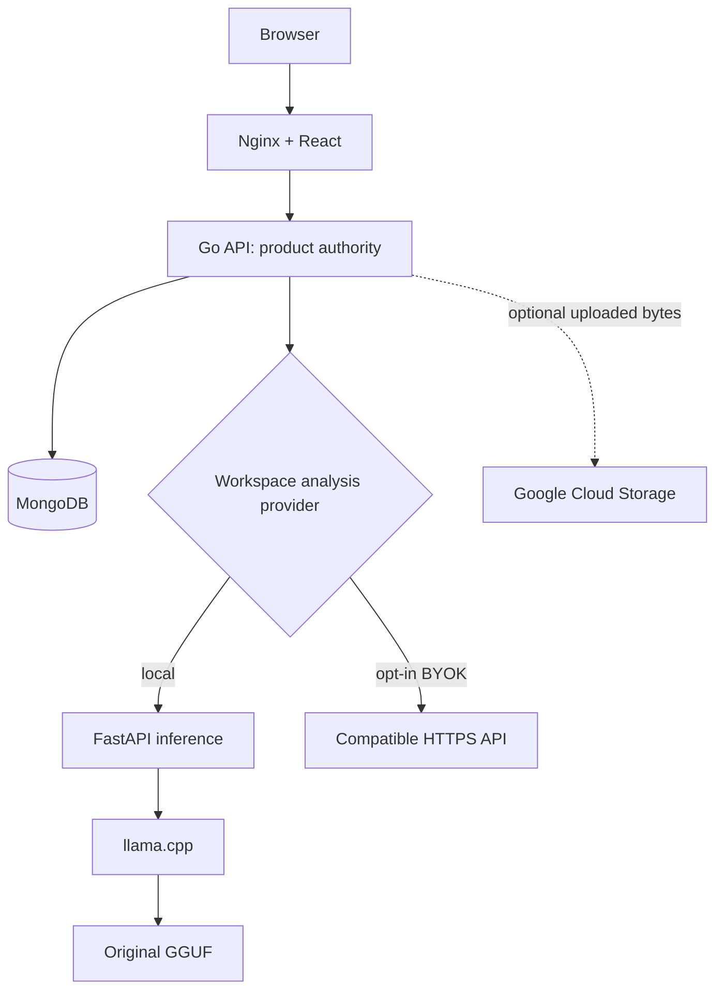
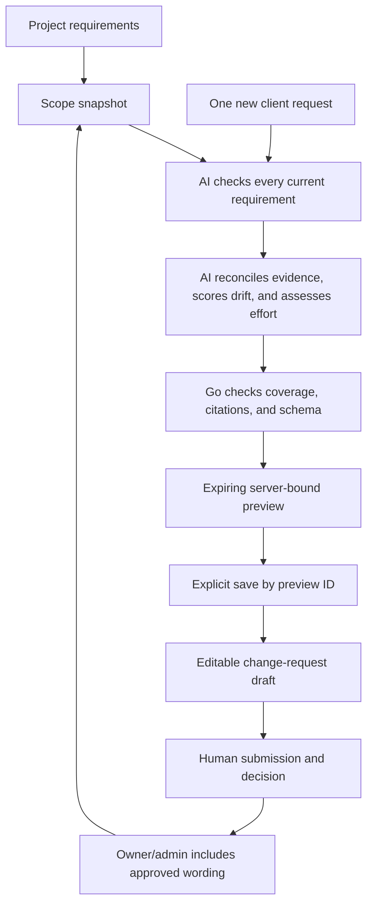

# Drift

Drift tracks how project requirements move after scope is agreed. It turns a later client request into a proposed comparison against a saved scope snapshot, shows the likely impact, and keeps the decision with the people responsible for the project.

The technically interesting boundary is deliberate: the selected local or workspace-owned online model proposes the scope relationship, drift scores, and work estimate. The Go application verifies complete evidence and owns authorization, persistence, and workflow state.

## Why I Built It This Way

A new request can sound small until someone compares it with what the team actually agreed to deliver. I wanted that comparison to be easy to make without letting a model quietly turn a suggestion into a decision. That is why Drift asks for a saved scope snapshot, shows the proposed impact, and keeps submission and approval as separate human steps. The extra step is intentional: it leaves a record the team can revisit when the conversation has moved on.

## Get Started

On Linux, install Git and Docker with Compose v2, then run:

```sh
git clone https://github.com/muneeb-anjum0/Drift.git
cd Drift
./scripts/setup-local.sh
```

Open **http://localhost:5173**. The script creates a private, ignored `.env` with independent keys and a unique Compose project name. It preserves an existing `.env` and Mongo volume. Docker may ask for sudo. The first build needs network access and may take several minutes. Keep the default localhost stack off the public Internet.

The repository does **not** contain the original 4.36 GiB GGUF or provider credentials. Projects, scope snapshots, and decisions work immediately. For AI comparison, either configure a workspace-owned BYOK provider in **Account → Analysis provider**, or install an authorized copy of the original model with `./scripts/install-original-model.sh /path/to/original.gguf` (add `--gpu` only on a configured NVIDIA host). The installer verifies the exact SHA-256 before starting llama.cpp. See [development](docs/development.md) for backup, updates, and platform limits.

## What Drift Does

Teams capture initial requirements, freeze the first scope snapshot, then compare one new request with every item in the current accepted revision. The selected AI provider proposes affected scope, marginal and cumulative drift, and an effort range or a clear “not estimable” result. A person reviews the proposal, edits a change request, and makes an approval decision. An owner/admin separately includes the approved wording in the next comparison revision. The original snapshot stays intact; a snapshot alone does **not** prove client approval.

## The Problem

Scope changes often arrive in messages long before anyone updates the original agreement. Without a stable reference, it is difficult to tell what changed, which requirements are affected, and whether the team actually accepted the change. Drift preserves the agreed-reference *snapshot* and makes the later interpretation and human decision explicit.

## How Drift Works

1. Record the initial requirements and freeze the first scope snapshot.
2. Enter one new client request. Drift checks it against **every** item in the current accepted revision; a durable job shows progress.
3. Review the model's proposed relationships, affected requirements, two drift scores, and effort range or unanswered questions.
4. Save the proposal, edit the change-request wording, and submit it for a human decision.
5. Include an approved change in the next scope revision. The following request is checked against that expanded or changed revision.

## Architecture

The source is grouped by responsibility:

| Folder | Contents |
| --- | --- |
| [`frontend/`](frontend/) | React app, browser tests, and Nginx image |
| [`backend/`](backend/) | Go API, domain services, and integration tests |
| [`ai_model/inference/`](ai_model/inference/) | Keyed FastAPI service and model runtime adapter |
| [`ai_model/artifacts/`](ai_model/artifacts/) | Local model files; weights are ignored by Git and mounted into containers at `/app/models` |
| [`ai_model/tooling/`](ai_model/tooling/) | Model download and conversion utilities |
| [`evaluation/`](evaluation/) | Research datasets, frozen protocols, and historical evidence |
| [`deploy/compose/`](deploy/compose/) | Optional GPU, staging, test, and rehearsal Compose overlays |
| [`tools/`](tools/) | Operational and verification scripts |

The main Compose file, Makefile, and first-run scripts stay at the repository root so setup still begins with one command. Frontend dependencies and their lockfile live under `frontend/`. Generated reports live in ignored `.local/reports/`.



React owns presentation and temporary browser state. Go enforces tenancy, permissions, state transitions, and persistence; MongoDB holds durable product and preview records. Provider output is advisory. Optional cloud storage holds file bytes, while Go retains file metadata and access control. See [architecture](docs/architecture.md).

## Drift Analysis Pipeline



The preview cannot be replaced with a browser-authored analysis at save time. The score and effort range are model claims, not guaranteed project forecasts; classification is a proposed interpretation, not a confirmed change. An incomplete full-scope check fails rather than declaring the request absent. [Rolling scope pipeline](docs/rolling_scope_pipeline_design.md) records the implementation and evaluation limits.

## Local Model + BYOK

The historical built-in option uses Drift's original Qwen-based GGUF through FastAPI and llama.cpp. The file is supplied separately, verified by SHA-256, and not committed. A separate SmolLM3-3B F16 Compose overlay provides an experimental 8 GB GPU route. Neither local model has yet been shown reliable for the new full-scope assessment. The core project/scope workflow runs without a model.

Alternatively, a workspace owner/admin can configure an OpenAI-compatible public HTTPS provider with their own API key. Both options now receive the same structured full-scope task. Historical label-only and four-field paths remain for diagnostics and old records. The provider cannot choose the workspace, change permissions, save an analysis, approve a request, or alter project state. External mode uses encrypted server-side credential storage and does not fall back silently if the selected provider fails. See [model and providers](docs/model-and-providers.md) and [security](docs/security.md).

## Engineering Highlights

- Server-side capability authorization and workspace/tenant isolation across project operations.
- One-time, expiring analysis previews bind the saved result to its user, project, snapshot, input, and actual provider; replay and retargeting are rejected.
- Encrypted BYOK credentials, public-endpoint/TLS restrictions, and connection-time address checks constrain the external-provider boundary.
- Versioned scope snapshots, atomic decision transitions, Mongo-backed integration tests, and model-free browser workflows keep application state testable independently of model quality.

## Security Model

The browser and provider responses are untrusted. The Go API is the business and authorization boundary; the local inference API requires a separate internal key. JWT and key settings fail closed, while readiness distinguishes core application health from optional model availability. The localhost Compose stack is **not** a hardened public deployment. See [security](docs/security.md) for controls and known limitations.

## Technology

| Layer | Technology |
| --- | --- |
| Frontend | React, TypeScript, Vite, Nginx |
| Backend and data | Go, Gin, MongoDB |
| Local inference | Python, FastAPI, llama.cpp, Qwen-based GGUF |
| Runtime and verification | Docker Compose, Go tests, pytest, Playwright, GitHub Actions |

Google Cloud Storage is an optional uploaded-file backend.

## Project Status

Drift is a **local-first** application. Its Linux x86-64 Docker Compose path, model-free product workflow, and a bounded CPU smoke of the original GGUF have been validated. BYOK is supported. Windows/macOS and end-to-end NVIDIA GPU operation are not claimed verified, and public staging/production deployment is not claimed complete. The rejected Phase III-J candidate remains research-only; the selected local artifact is the original GGUF. The sealed final model holdout was not used for release engineering. See [deployment](docs/deployment.md) and [research history](docs/research-history.md).

Drift's source is licensed under the existing [Apache License 2.0](LICENSE). That license does not supply rights to separately distributed model weights or third-party provider services.

## Documentation

- [Architecture](docs/architecture.md) — system boundaries, tenancy, workflow, and data flow.
- [Development](docs/development.md) — local setup, verification, model startup, and troubleshooting.
- [Deployment](docs/deployment.md) — validated local distribution versus proposed staging.
- [Security](docs/security.md) — trust boundaries, credentials, preview integrity, and limitations.
- [Model and providers](docs/model-and-providers.md) — local inference contract and BYOK behavior.
- [Operations](docs/operations.md) — health, backup/restore, monitoring, and rollback.
- [Research history](docs/research-history.md) — frozen evidence, model decisions, and historical custody.
