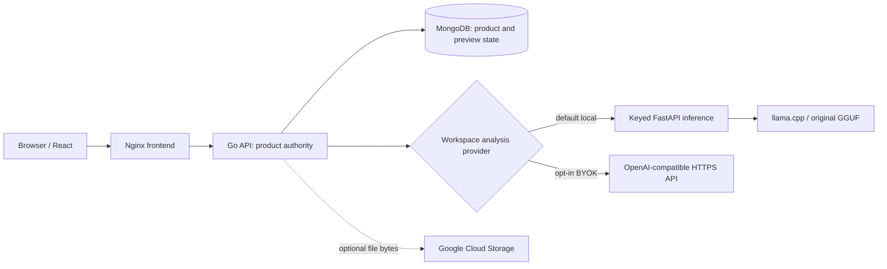

# Architecture

Drift is a local-first requirement-change management application. Its central design rule is that the Go API owns product authority; the browser presents workflows and the inference service supplies an untrusted classification input.

## System boundaries



| Component | Responsibility | Does not own |
| --- | --- | --- |
| `client/` | Pages, domain UI, hooks, typed HTTP clients | Authorization or workflow truth |
| `server-go/` | REST contract, tenant policy, provider selection, state transitions, drift orchestration, preview binding, persistence | Model loading |
| `services/inference/` | Model configuration, prompt/runtime adaptation, output validation | Product decisions or persistence |
| MongoDB | Workspaces, projects, requirements, baselines, analyses, change requests, activity | Uploaded document bytes |
| llama.cpp | GGUF execution when the model profile is explicitly started | Validation or product authority |
| Cloud Storage | Optional uploaded object bytes | Tenant metadata or permissions |

The normal request direction is `pages -> features -> hooks -> api` in the client and `routes -> handlers -> services -> MongoDB/external boundary` in the backend. Go packages under `internal/` are intentionally not public libraries.

## Product request flow

1. The browser authenticates against the Go API and sends its JWT on protected requests.
2. Middleware validates the token and resolves the current user.
3. Services call the centralized authorization policy before reading or mutating tenant-owned state.
4. Handlers map stable domain errors to HTTP responses; MongoDB remains the system of record.
5. The browser renders the authoritative API result.

## Tenancy and authorization

Every project belongs to a workspace. Workspace membership supplies one of four roles: `owner`, `admin`, `member`, or `viewer`. `internal/authorization/policy.go` maps those roles to read, write, approve, manage-workspace, and delete-workspace capabilities. Project authorization first loads the project, then derives permission from its workspace membership. Client-side visibility is convenience only and never replaces this server-side check.

## Requirements and scope snapshots

Requirements are mutable working records. Creating a baseline stores a historical **scope snapshot** rather than a live reference. The snapshot includes the current requirements, including any proposed/rejected statuses; its creation is **not** formal approval of the agreement. Baseline version allocation is protected by a unique index and retry behavior so concurrent requests cannot create duplicate versions. The saved snapshot is the selected comparison reference for later analysis.

## Drift pipeline

```text
client message
  -> baseline snapshot lookup
  -> requirement relevance scoring
  -> selected workspace provider and bounded per-requirement calls (when enabled)
  -> response contract validation
  -> normalization and post-processing
  -> deterministic score/risk/effort aggregation
  -> server-generated, expiring preview ID
  -> explicit save by preview ID
```

`drift_service.go` owns orchestration; `provider/` selects the authorized workspace provider; `inference_client.go` owns the authenticated Go-to-FastAPI boundary; `drift_postprocess.go` owns tested output cleanup and model compensation; `drift_scoring.go` owns aggregation; and `preview.go` binds analyze output to a short-lived Mongo preview consumed by save. The browser cannot repost or edit the analysis body at save. Analysis is preview-first: generated output is not durable until the user explicitly saves it.

The canonical rules in `drift_postprocess.go` include general normalization plus model-compensation rules for the evaluation/demo domains. They are intentionally retained because tests and current behavior depend on them. Treat them as untrusted-model containment and known debt, not as a second source of product authorization.

## Inference boundary

FastAPI has four cohesive responsibilities:

- `config.py`: environment-backed runtime configuration and model labels;
- `contracts.py`: bounded request/response types and hostile-output normalization;
- `runtime.py`: PEFT/GGUF adaptation and llama.cpp communication;
- `app.py`: authentication, lifecycle, health, and HTTP routing.

The backend authenticates with `X-Drift-Inference-Key`. Both FastAPI and Go validate local model output. The external BYOK adapter has its own URL, TLS, credential, and result-validation boundary. A provider response can influence a preview, but it cannot bypass tenant checks, state transitions, or explicit persistence. Provider failure does not silently switch to another provider.

## Change requests and approvals

Change requests have an explicit approval state machine:

```text
draft -> pending_approval -> approved
                          -> rejected
                          -> needs_revision -> pending_approval
```

Transitions and history updates remain atomic at the MongoDB document boundary. Competing decisions cannot both win. A change-request draft remains human-editable, but its `generatedBy` provenance is derived from the persisted analysis, not browser input.

## Documents and deletion

MongoDB owns file metadata and workspace/project tenancy. Optional Cloud Storage owns bytes. Uploads are bounded and content-checked; storage failures do not report false success. Cascading deletion is retry-safe because the supported standalone MongoDB deployment does not provide cross-collection transactions.

## Health and deployment

The backend exposes liveness separately from readiness. MongoDB is required for backend readiness; inference is intentionally optional so non-model product workflows remain usable. FastAPI liveness can be healthy while model readiness is `503` when llama.cpp is stopped. The default Compose stack does not start the model profile.

See [development](development.md), [deployment](deployment.md), [security](security.md), and [model/providers](model-and-providers.md) for the constraints that protect these boundaries.
