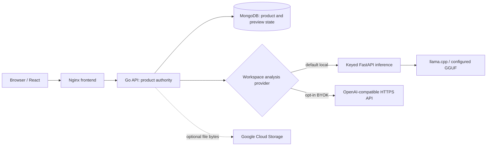

# Architecture

Drift is a local-first requirement-change management application. Its central design rule is that the Go API owns product authority; the browser presents workflows and the selected AI provider supplies untrusted scope assessments.

## System boundaries



| Component | Responsibility | Does not own |
| --- | --- | --- |
| `frontend/` | Pages, domain UI, hooks, typed HTTP clients | Authorization or workflow truth |
| `backend/` | REST contract, tenant policy, provider selection, state transitions, drift orchestration, preview binding, persistence | Model loading |
| `ai_model/inference/` | Model configuration, prompt/runtime adaptation, output validation | Product decisions or persistence |
| MongoDB | Workspaces, projects, requirements, baselines, analyses, change requests, activity | Uploaded document bytes |
| llama.cpp | GGUF execution when the model profile is explicitly started | Validation or product authority |
| Cloud Storage | Optional uploaded object bytes | Tenant metadata or permissions |

The normal request direction is `pages -> features -> hooks -> api` in the frontend and `routes -> handlers -> services -> MongoDB/external boundary` in the backend. Go packages under `internal/` are intentionally not public libraries.

## Product request flow

1. The browser authenticates against the Go API and sends its JWT on protected requests.
2. Middleware validates the token and resolves the current user.
3. Services call the centralized authorization policy before reading or mutating tenant-owned state.
4. Handlers map stable domain errors to HTTP responses; MongoDB remains the system of record.
5. The browser renders the authoritative API result.

## Tenancy and authorization

Every project belongs to a workspace. Workspace membership supplies one of four roles: `owner`, `admin`, `member`, or `viewer`. `internal/authorization/policy.go` maps those roles to read, write, approve, manage-workspace, and delete-workspace capabilities. Project authorization first loads the project, then derives permission from its workspace membership. Client-side visibility is convenience only and never replaces this server-side check.

## Requirements and scope snapshots

Requirements are editable while the initial agreement is being assembled. The first freeze stores an immutable **original scope snapshot** and makes it the project's current comparison revision. It includes the entered statuses, even proposed or rejected ones; freezing does **not** prove client approval. After the freeze, direct requirement edits are blocked. An owner/admin can include an approved change request to publish a new immutable revision; the project pointer advances only if the analyzed revision is still current. The original stays available for cumulative comparison. A unique index prevents duplicate version numbers, and concurrent original freezes have one winner.

## Drift pipeline

```text
client message
  -> current immutable scope revision + original snapshot lookup
  -> durable job and selected workspace provider
  -> AI pair assessment for every active requirement, in batches
  -> AI synthesis of proposed changes, two drift scores and effort range/unknown
  -> Go validates complete IDs, citations, schema and numerical bounds
  -> server-generated, expiring preview ID
  -> explicit save by preview ID
  -> human-edited change request and approval
  -> explicit inclusion publishes the next comparison revision
```

`drift_service.go` owns orchestration; `scope_job.go` persists progress and resumes interrupted batches; `full_scope_assessment.go` builds model calls; `scope_assessment.go` checks structural integrity; `provider/` selects the authorized workspace provider; `inference_client.go` owns the authenticated Go-to-FastAPI boundary; and `preview.go` binds analyze output to a short-lived Mongo preview consumed by save. The browser cannot repost or edit the analysis body at save. Analysis is preview-first: generated output is not durable until the user explicitly saves it.

Historical label-only evaluation and postprocessing code remains for old records and diagnostics. The new product comparison does not call the lexical relevance, fixed-weight scoring, effort tables, or model-compensation helpers. Their continued presence is legacy debt; they are not an alternative semantic path when the selected provider fails.

## Inference boundary

FastAPI has four cohesive responsibilities:

- `config.py`: environment-backed runtime configuration and model labels;
- `contracts.py`: bounded request/response types and hostile-output normalization;
- `runtime.py`: PEFT/GGUF adaptation and llama.cpp communication;
- `app.py`: authentication, lifecycle, health, and HTTP routing.

The backend authenticates with `X-Drift-Inference-Key`. Both FastAPI and Go validate local model output. The external BYOK adapter has its own URL, TLS, credential, and result-validation boundary. A provider response can influence a preview, but it cannot bypass tenant checks, state transitions, or explicit persistence. Provider failure does not silently switch to another provider.

## Change requests and approvals

Change requests have an explicit approval state machine:

```text
draft -> pending_approval -> approved
                          -> rejected
  -> needs_revision -> pending_approval
```

Transitions and history updates remain atomic at the MongoDB document boundary. Competing decisions cannot both win. A change-request draft remains human-editable, but its `generatedBy` provenance is derived from the persisted analysis, not browser input. Approval records a human decision; a separate inclusion action advances the current scope. Neither a saved analysis nor an approved but unincluded request changes the next comparison point.

## Documents and deletion

MongoDB owns file metadata and workspace/project tenancy. Optional Cloud Storage owns bytes. Uploads are bounded and content-checked; storage failures do not report false success. Cascading deletion is retry-safe because the supported standalone MongoDB deployment does not provide cross-collection transactions.

## Health and deployment

The backend exposes liveness separately from readiness. MongoDB is required for backend readiness; inference is intentionally optional so non-model product workflows remain usable. FastAPI liveness can be healthy while model readiness is `503` when llama.cpp is stopped. The default Compose stack does not start the model profile.

See [development](development.md), [deployment](deployment.md), [security](security.md), and [model/providers](model-and-providers.md) for the constraints that protect these boundaries.
