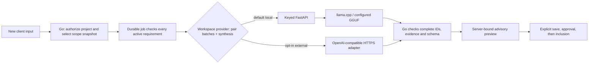

# Model and Analysis Providers

Drift's Go pipeline owns authorization, full-scope orchestration, structural validation, and persistence. The selected AI provider proposes pair relationships, request-level changes, marginal and cumulative drift scores, and an effort range or questions. Neither provider can decide permissions, change-request approval, or whether an approved change enters current scope.

## Supported model and current contract

The historical production local artifact is `ai_model/artifacts/gguf/DriftLedger-Qwen2.5-7B-Q4_K_M.gguf`, 4,683,074,112 bytes, SHA-256 `11e2ca8d10f6b52693256addca9b8f0d5bb01eebc53594b531586ea992419ac9`. It is ignored by Git and must come from authorized custody. The optional `deploy/compose/smollm3.yml` overlay mounts a separately supplied SmolLM3-3B F16 GGUF as an **experimental** local alternative for this new scope contract. Neither model has passed a quality gate for this new multi-step task. The normal Compose stack starts without llama.cpp; core project/scope workflows work without a model. The rejected Phase III-J candidate must never be mounted under the original path.

The new product comparison calls the same `scope-assessment-v1` contract for local and BYOK providers. The model returns a relationship for every active requirement, then reconciles the complete ledger into proposed changes, scores, risk, and effort. Go rejects missing IDs, invalid quotes, invalid scores, and incomplete output; it does not fill semantic fields with rules. Saved results carry `server_bound_ai_scope_v1` provenance. Historical label-only and four-field diagnostic/evaluation routes remain, and old analyses remain readable. No model result implies approval.

## Workspace selection and credential lifecycle

No workspace provider record means local mode. Workspace owners/admins can choose OpenAI, Google Gemini, DeepSeek, or another public HTTPS endpoint that implements OpenAI-compatible Chat Completions and JSON output. The named choices fill a fixed endpoint; the user supplies a model ID and the key issued by that provider. A ChatGPT subscription is not an OpenAI API key. The backend tests a synthetic case before saving the encrypted key and routes later analyses through that saved workspace choice. Other providers need a compatible API; arbitrary provider-specific protocols are not accepted. Members see only safe metadata. The project is loaded and authorized first, then its persisted workspace selects the provider. A request-supplied workspace ID never selects credentials. The browser acknowledges that selected requirement text and new client input will leave the local machine in online mode.

Saving an online provider is one action: the server tests the key and model with synthetic text, then encrypts and saves only after success. Switching to local mode pauses online routing while retaining the encrypted provider settings. Switching back tests the saved connection before reactivating it; a failed test leaves local mode active. The separate “Forget provider and key” action permanently deletes the saved configuration. Settings shows whether a key is saved without displaying the key itself.

The key crosses the browser's own network request once during connection test and save. The Go service encrypts it with AES-GCM and a separate `DRIFT_PROVIDER_MASTER_KEY` before Mongo storage; provider reads return only metadata, never the key or ciphertext. Responses use `Cache-Control: no-store`. The key is cleared from the form after save. Someone operating the browser can inspect the key while typing it or inspect their own request in developer tools, so this is not a way to hide a key from its owner or a compromised browser. Use HTTPS for access beyond localhost and protect the master key separately from Mongo backups.

For Gemini, Settings suggests text model IDs with a Standard API free tier listed in [Google's pricing table](https://aistudio.google.com/docs/pricing): `gemini-3.8-flash`, `gemini-3.5-flash-lite`, `gemini-3.1-flash-lite`, and `gemini-3-flash-preview`. Availability and quotas depend on the Google project. Google says free-tier content may be used to improve its products, so the provider choice must be made with the project's data policy in mind.

The independent base64-encoded 32-byte `DRIFT_PROVIDER_MASTER_KEY` enables external mode; local mode needs no such key. The backend encrypts saved API keys using AES-256-GCM with a fresh nonce and workspace/provider-bound authenticated data. Ciphertext, nonce and version—not plaintext—reside in Mongo. The key stays outside Git and must be separately backed up; losing it makes saved credentials unusable. Saved keys are never returned. Replacement tests the new key before atomic ciphertext replacement; switching to local/delete clears the external credential, not historical analyses. Master-key rotation requires a separately reviewed migration; unknown versions and decryption failures fail closed.

## External endpoint and result boundary

The adapter accepts only canonical public-domain HTTPS URLs on port 443, without userinfo, query, fragment, redirects, or IP-literal host. It appends only the fixed `/chat/completions` path. Proxy environment variables and insecure TLS are not honored. Every connection re-resolves A/AAAA, rejects special-use/private/loopback/link-local/metadata addresses, and dials an approved resolved IP while retaining the hostname for SNI and certificate verification. This protects test and inference against redirect/DNS-rebinding SSRF. Private self-hosted endpoints are intentionally unsupported in this initial BYOK mode.

Provider responses are size/schema bounded and validated before reaching Go's advisory preview. Prompt text is untrusted data, not instructions with authority over HTTP targets, tools, files, or workflow. The selected provider's failure returns a sanitized error and **never silently falls back** to local or rule-based inference. No failed provider response becomes a saved analysis. The job records provider type, model label, and configuration revision so a changed connection fails instead of silently switching. Direct diagnostic routes remain local-only. Secrets and raw provider request/response bodies must not enter logs or preview records.

## Scope-level comparison and uncertainty

Drift takes **one request at a time** and checks it against **every** requirement in the project's current accepted revision. It batches model calls without omitting IDs. The model reconciles the complete ledger; one unrelated pair cannot by itself prove a new feature. The model, not Go, assigns marginal drift relative to current scope and cumulative drift relative to the original snapshot. The resulting score is a proposed assessment, not contractual truth. Approved additions enter a new immutable revision, so the following request checks the expanded scope.

Pairwise labels cannot mathematically prove absence from a natural-language agreement. The complete ledger, exact cited text, and request-level explanation are presented for review. If the model marks a result uncertain, it cannot become a change request without a clarified comparison. If the implementation context is insufficient, effort is `not_estimable` with questions; Go does not invent zero hours. Users should check proposed additions and affected existing requirements before deciding. Independent semantic evaluation of both providers is still required; see [rolling scope pipeline](rolling_scope_pipeline_design.md).

Read [security](security.md) for preview binding, replay prevention, and authorization; [research history](research-history.md) for why the rejected label-only candidate does not replace the original; and [architecture](architecture.md) for the full workflow.
