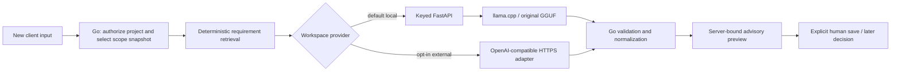

# Model and Analysis Providers

Drift's Go pipeline owns authorization, requirement retrieval, normalization, impact presentation, and persistence. The inference-provider abstraction supplies a **proposed** six-class relationship for a selected requirement and new client text. Neither a local model nor an external provider can decide permissions, baseline ownership, change-request state, or any business mutation.

## Supported model and current contract

The only supported local artifact is `models/gguf/DriftLedger-Qwen2.5-7B-Q4_K_M.gguf`, 4,683,074,112 bytes, SHA-256 `11e2ca8d10f6b52693256addca9b8f0d5bb01eebc53594b531586ea992419ac9`. It is ignored by Git and must come from authorized custody; no public download URL is promised. The normal Compose stack starts **without** llama.cpp. Model operation is optional for project/scope workflows but necessary for local AI comparison. CPU startup and optional GPU overlay are in [development](development.md). The rejected Phase III-J candidate must never be mounted under the original path.

The semantic task is one of `added`, `modified`, `removed`, `contradiction`, `ambiguous`, `unchanged`. Research concluded that a label-only model responsibility is better aligned with available reviewed labels. **The shipped production API has not migrated to label-only.** The local FastAPI/Go path still validates `label`, numeric `confidence`, `reasoning`, and `changed_elements`; the external OpenAI-compatible adapter uses the same bounded four-field prediction. Confidence is self-reported, not calibrated probability; reasoning and changed elements are not supported by reviewed Phase III-J field targets. Go also has explicit rule-based/no-prediction paths and derives scores, effort, and presentation. Do not infer that every displayed label came from a model.

## Workspace selection and credential lifecycle

No workspace provider record means local mode. Workspace owners/admins may test and save one `openai_compatible` HTTPS provider configuration; members can see only safe metadata. The project is loaded and authorized first, then its persisted workspace selects the provider. A request-supplied workspace ID never selects credentials. The browser acknowledges that selected requirement text and new client input will leave the local machine in external mode. Drift does not sell provider tokens or implement vendor-specific Anthropic/Gemini adapters.

The independent base64-encoded 32-byte `DRIFT_PROVIDER_MASTER_KEY` enables external mode; local mode needs no such key. The backend encrypts saved API keys using AES-256-GCM with a fresh nonce and workspace/provider-bound authenticated data. Ciphertext, nonce and version—not plaintext—reside in Mongo. The key stays outside Git and must be separately backed up; losing it makes saved credentials unusable. Saved keys are never returned. Replacement tests the new key before atomic ciphertext replacement; switching to local/delete clears the external credential, not historical analyses. Master-key rotation requires a separately reviewed migration; unknown versions and decryption failures fail closed.

## External endpoint and result boundary

The adapter accepts only canonical public-domain HTTPS URLs on port 443, without userinfo, query, fragment, redirects, or IP-literal host. It appends only the fixed `/chat/completions` path. Proxy environment variables and insecure TLS are not honored. Every connection re-resolves A/AAAA, rejects special-use/private/loopback/link-local/metadata addresses, and dials an approved resolved IP while retaining the hostname for SNI and certificate verification. This protects test and inference against redirect/DNS-rebinding SSRF. Private self-hosted endpoints are intentionally unsupported in this initial BYOK mode.

Provider responses are size/schema/label bounded, normalized, and validated before reaching Go's advisory preview. Prompt text is untrusted data, not instructions with authority over HTTP targets, tools, files, or workflow. The selected provider's failure returns a sanitized error and **never silently falls back** to local or rule-based inference. No failed provider response becomes a saved analysis. Analysis provenance records the provider that actually executed, even if workspace selection later changes; no-prediction retrieval is marked `rule_based`. Direct diagnostic routes remain local-only. Secrets and raw provider request/response bodies must not enter logs or preview records.

Read [security](security.md) for preview binding, replay prevention, and authorization; [research history](research-history.md) for why the rejected label-only candidate does not replace the original; and [architecture](architecture.md) for the full workflow.
