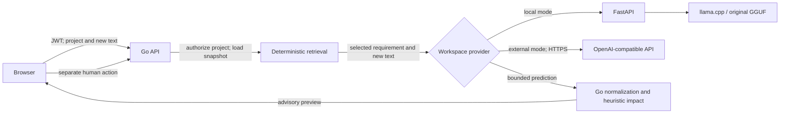
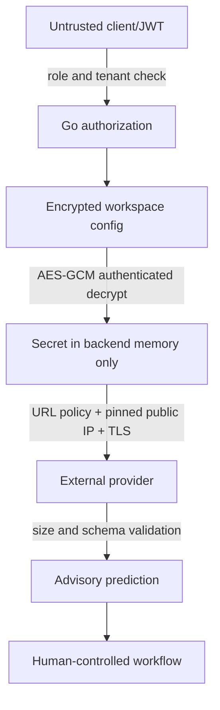

# Workspace analysis providers

## 1. Goals

Keep Drift local-first while allowing a workspace to opt into a user-funded, OpenAI-compatible HTTPS analysis provider. The Go API remains the product and authorization boundary. Provider output is advisory, never a scope or approval decision.

## 2. Non-goals

This does not add hosted Drift, token resale, billing, agent tools, vendor-specific Anthropic/Gemini adapters, model training, or a new production model. Existing diagnostic direct-inference endpoints remain local-only; they cannot select or use a workspace credential.

## 3. Provider model

One selected analysis provider per workspace: `local` (the default when no record exists) or `openai_compatible`. A single Go provider interface supplies `Health`, `Predict`, identity, and the existing retrieval limits. The local implementation keeps the FastAPI → llama.cpp path. The external implementation calls `/chat/completions` with a four-field structured response and no tools. Drift parses and bounds the response before it reaches its existing normalization and impact logic. No automatic fallback occurs when the selected provider fails.

## 4. Workspace ownership

The configuration is keyed by workspace ID with a unique index. Any member may read non-secret provider metadata. Only owner/admin may test, set, replace, switch, or delete. Project analysis resolves the project first, checks the caller's existing write capability, and uses *that project's workspace* to select the provider. Request-supplied workspace IDs never choose analysis credentials.

## 5. Data flow

Only the selected requirements (up to the existing configured limit) and current client text leave Drift in external mode. No account profile, unrelated project, files, or history is sent.

## 6. Credential encryption

AES-256-GCM with a fresh 96-bit random nonce for every encryption. The server reads a base64-encoded 32-byte `DRIFT_PROVIDER_MASTER_KEY` from its environment; it is never stored in Mongo, returned to clients, or generated silently. The authenticated additional data is a versioned encoding of workspace ID, provider record ID, and provider type. The record stores only ciphertext, nonce, and key version. Authentication failure (wrong key, wrong workspace, tampering) fails closed. Version `1` identifies the initial key; a future re-encryption migration must be explicit and atomic before retiring a key. An absent key does not block local mode, but forbids creating or using external credentials.

## 7. API design

Under authenticated `/api/v1/workspaces/:workspaceId/provider`:

| Method | Permission | Effect |
| --- | --- | --- |
| GET | workspace read | safe metadata: selected type, display name, endpoint, model, enabled/configured state, last validation category/time; never ciphertext or key |
| POST `/test` | manage workspace | test proposed values or existing saved config with a bounded request; no model output returned or persisted |
| PUT | manage workspace | validate shape, test unsaved key, then encrypt and atomically replace config; `local` clears external credential |
| DELETE | manage workspace | delete encrypted config and return to default local selection; project/analysis history is untouched |

No secret is returned after save. Replacing a key requires entering a new one. The external privacy acknowledgment is required on first external setup. Provider test and write endpoints use the existing inference rate limiter in addition to authorization.

Analysis persistence uses a short-lived, server-side preview ID: `/drift/save` accepts the ID alone and persists the exact backend-produced result. `analysisEngine` records the provider that actually ran at analyze time, even if workspace selection changes before save; a no-prediction retrieval path is marked `rule_based`. No provider credentials enter preview records. See [Analysis persistence integrity](analysis_integrity.md) for the trust boundary, expiry, replay, and historical-provenance rules.

## 8. SSRF and TLS controls

External mode accepts only canonical `https` URLs with no URL userinfo, query, fragment, redirect, non-443 port, or IP-literal host. The submitted base path is bounded and may only be extended by the fixed `/chat/completions` path. The HTTP client does not honor proxy environment variables, does not follow redirects, and preserves ordinary certificate and hostname validation; there is no insecure-TLS switch. Each connection resolves A/AAAA itself, rejects every forbidden result (loopback, private, link-local, metadata/shared/reserved/special-use networks), and dials an approved resolved IP directly while preserving the original hostname for SNI and certificate verification. Thus a second DNS lookup cannot retarget the connection. Policy is applied on test and inference requests. There is no self-hosted/private-network exception in this initial release. Test doubles inject a transport in tests only; no runtime insecure override exists.

The connection-time check and redirect ban address DNS rebinding and redirect bypasses identified by the [OWASP SSRF Prevention Cheat Sheet](https://cheatsheetseries.owasp.org/cheatsheets/Server_Side_Request_Forgery_Prevention_Cheat_Sheet.html).

## 9. Privacy

Settings must warn: “The selected agreed requirement and new client input used for analysis will be sent to this provider.” An owner/admin acknowledges this before first external save. Local mode remains the privacy-first default and requires no provider key.

## 10. Authorization

Every provider endpoint authenticates JWT and calls the existing workspace capability policy. GET requires read; POST/PUT/DELETE require manage-workspace. Neither frontend hiding nor provider possession grants a role. Analysis continues to require project write capability; viewer cannot run it. Tenant selection is derived from the authorized project, not caller-supplied provider configuration.

## 11. Logging

Never log provider headers, key, raw configuration, raw provider response, or provider request body. Log only provider type, workspace ID, model, duration and coarse status category where operationally necessary. Error responses contain fixed safe categories, never provider error body or URL containing credentials. Activity entries must not contain credentials.

## 12. Provider contract

The only allowed labels are `added`, `modified`, `removed`, `contradiction`, `ambiguous`, and `unchanged`. The external prediction must be one JSON object with `label`, numeric `confidence` in `[0,1]`, bounded `reasoning`, and a bounded `changed_elements` string array. Unknown/missing fields, extra JSON, oversized bodies, or unknown labels fail closed. Prompt sections clearly separate system instructions from untrusted baseline/client text. No tools/functions are enabled, and provider content cannot select database queries, HTTP targets, files, or workflow transitions.

## 13. Failure behavior

No local runtime: local analysis reports unavailable, without a fabricated analysis. External auth failure, unknown model, rate limit, timeout, unavailable server, malformed response, or missing/wrong master key produces a sanitized error and no saved result. The app's non-AI project/scope workflow remains available. External failure never silently uses local or rule-based inference. `/health` and `/ready` continue to represent core API/Mongo health; per-workspace analysis readiness is separate.

## 14. Key rotation

Credential replacement tests the new key before atomically storing new ciphertext and nonce; the prior value is not retained in application history. Master-key rotation is not implicit: a future operator-run migration must read version 1 with the old key, write new version with a new key, verify, and only then retire the old key. An unknown key version fails closed.

## 15. Local provider coexistence

No provider record means local mode. The original GGUF and local FastAPI contract are unchanged. Switching external → local removes stored external credentials, while existing analyses remain. Existing diagnostic routes stay local-only. The original production model identity remains unchanged.

## 16. Future adapters

Future non-compatible providers must implement the same prediction interface with their own validated request/response adapter and threat review. “OpenAI-compatible” is a protocol mode, not a claim that every vendor implements it.

## 17. Threat model

Primary threats are cross-workspace credential use, key disclosure, SSRF (including redirects and DNS rebinding), prompt injection, malformed model output, and silent provider switching. Controls above are required by tests, including Mongo plaintext inspection and secret-leak searches. A local installation operator with host/process access can read environment secrets; this is an explicit local-first trust boundary, not protection against a compromised host.

## 18. Security decisions

Architecture gate: **BYOK_ARCHITECTURE_APPROVED** for implementation only with the connection-time SSRF policy, authenticated encryption, workspace-derived routing, and fail-closed semantics above. This is not an implementation or release approval. If any of these controls cannot be implemented and verified, the later phase is blocked; a permissive fallback is not acceptable.
